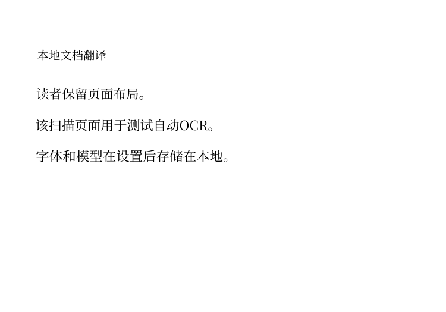
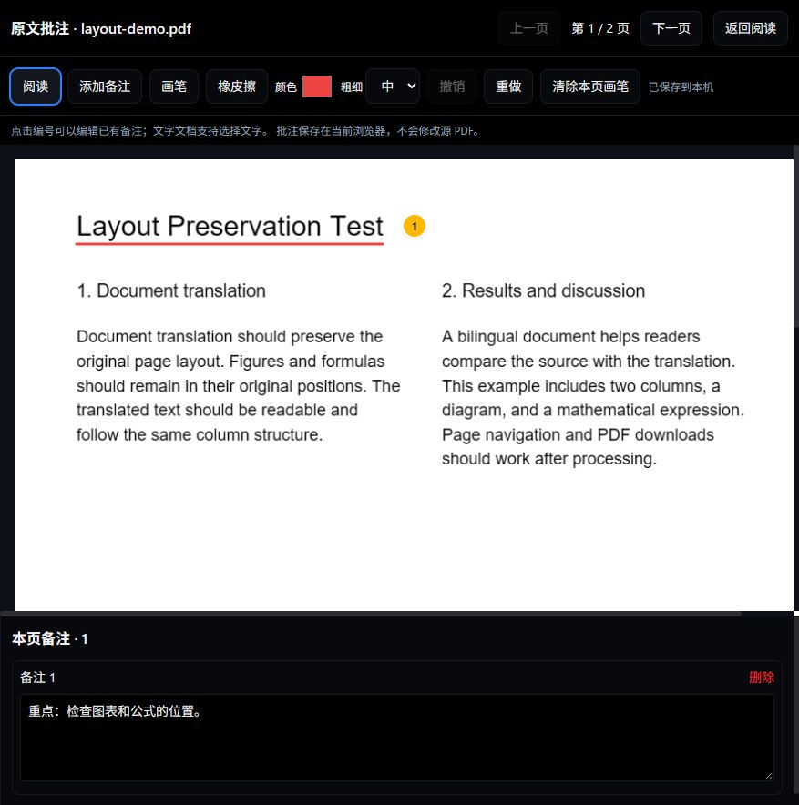

# EasyReader Translator

本地运行的双语 PDF 阅读与翻译工具。默认使用 Bing 免 Key 网页通道，也可选择 Google、Gemini 或自定义 AI 接口。

[English](docs/README.en.md) · [贡献指南](CONTRIBUTING.md) · [问题反馈](https://github.com/jasonroject/easyreader-translator/issues)

## 功能

- 导入真实 PDF，阅读原文、译文与双语段落；右下角开始翻译。
- 粘贴翻译：独立双栏文字翻译器，默认 Bing，可切换 Google，支持语言互换和复制译文。
- 白天 / 黑夜主题、阅读历史、术语与导出。
- 原文批注：按页添加定位备注、画笔、颜色与粗细、橡皮擦、撤销 / 重做，刷新后恢复。
- BabelDOC 保留版式模块：生成译文 PDF 和左右双语 PDF，尽量保留图像、公式和页面布局。
- 扫描页自动补充本地 OCR 文字层；已有 OCR 层采用扫描页兼容处理。当前 OCR 主要支持中英文印刷体。
- 首次准备模型和字体后复用缓存；不需要每次翻译重新安装依赖。

这是早期版本。复杂表格、密集页面、倾斜或低清扫描件需要检查输出；保留版式并不保证像素级还原。

下图为项目自制扫描页经过本地 OCR 和 Bing 翻译后的实际输出：



## 快速开始

1. 安装 [Node.js](https://nodejs.org/) **22.19 或以上**（推荐 24）。
2. 下载仓库 ZIP 并完整解压，或运行 `git clone https://github.com/jasonroject/easyreader-translator.git`。
3. Windows 双击 `start.cmd` 或 `一键启动.cmd`。macOS / Linux 在项目目录运行 `sh start.sh`；macOS 也可 `chmod +x start.command` 后双击。
4. 首次启动自动执行 `npm ci`，构建页面并打开浏览器。默认地址为 `http://127.0.0.1:3000`；被占用时自动寻找可用端口，并在 `.local-port` 中记住选择。运行期间保留启动窗口。

也可在终端运行：

```sh
npm ci
npm start
```

不能直接双击 `index.html` 使用。本项目需要本地服务处理翻译请求。

### 保留版式与扫描件

先安装 [uv](https://docs.astral.sh/uv/getting-started/installation/)，再运行：

```sh
npm run setup:layout
```

Windows 也可双击 `准备版式资源.cmd`。该步骤自动创建 Python 3.12 环境、安装锁定依赖，并预先下载 BabelDOC 的版面模型、字体与字符映射。OCR 模型随 RapidOCR 包安装。首次下载需要联网及足够磁盘空间，随后只补充缺失或损坏资源。也可以直接创建版式任务，让应用首次自动准备。

打开「保留版式」，选择 PDF → 选择目标语言 →「生成保留版式 PDF」，完成后下载译文或双语文件。无需 Gemini Key。扫描页先在本机识别，再把识别出的正文交给选定翻译服务。

生成结果默认连续滚动阅读，支持缩放和输入页码跳转；只渲染阅读位置附近的页面。这里的连续阅读用于生成后的 PDF，目前仍需等待整份翻译完成后查看结果。

字体沿用 BabelDOC 的自动匹配，支持多语言回退。未捆绑 Microsoft Times New Roman；单一西文字体无法代替 OCR 或覆盖中文译文。

## 粘贴翻译

点击第二行工具栏「粘贴翻译」，左侧输入或粘贴文字，选择语言后点击「翻译文本」（快捷键 Ctrl / ⌘ + Enter）。右侧显示译文，可复制或交换语言继续翻译。默认 Bing，也可切换 Google；单次最多 5000 字符。

该窗口不替换已导入的 PDF。关闭后重新打开会保留本次输入，刷新页面后清空。修改文字、语言或引擎会清除旧译文，防止错配。

交换按钮在翻译前也可使用：已有译文时用译文作为新输入，否则保留输入文字。自动识别尚无结果时，目标为中文则切换至中文→英语，其他目标则切换至该语言→简体中文，并提示你按需修改。

## 原文备注与画笔

点击阅读区上方「原文批注 · 备注 / 画笔」进入编辑器。选择「添加备注」后点击原文位置，在备注区输入；选择「画笔」可画线和圈画；「橡皮擦」点击删除一条笔迹。撤销 / 重做作用于当前页、当前编辑会话。支持 PDF 和文字文档，批注按文档、按页自动保存到浏览器 IndexedDB。

目前批注用于本机阅读，不改写原始 PDF，也不随现有译文 PDF / HTML 导出或临时同步功能导出。清理浏览器数据会删除批注；更换浏览器或端口不会自动迁移。



## 更换电脑与配置

复制或下载**源代码**，在新设备重新运行启动和资源准备。不要迁移 `node_modules` 或 `.babeldoc-venv`，它们与系统及安装路径有关。Windows 已做本地验证；macOS / Linux 已提供启动路径及 CI 配置，完整 GUI / 版式流程仍需相应设备验证。

把 `.env.example` 复制为 `.env.local` 可修改端口、代理与 Gemini 设置。Bing、Google 无需 Key；Gemini 的摘要、图片 OCR 和翻译需要同时设置 `GEMINI_API_KEY` 与你账户可用的 `GEMINI_MODEL`。自定义 AI 在界面设置。

免 Key 通道是非官方网页接口，可能限流、变更或受地区网络影响，不提供可用性保证。Google 报 429 时请稍后重试或切换 Bing。

## 数据与隐私

- 文档和阅读状态保存在浏览器 LocalStorage / IndexedDB；更换端口或浏览器不会自动迁移。
- 保留版式的原文、OCR 中间文件及输出位于 `.layout-jobs/`；用完后关闭应用，可手动删除该目录。
- Python 环境位于 `.babeldoc-venv/`；BabelDOC 资源及翻译缓存通常位于用户目录 `.cache/babeldoc/`。缓存可能包含正文译文，清理时注意这一点。
- 文本翻译会发送正文到所选服务；Gemini 图片 OCR 会发送图片；本地扫描识别本身不上传页面图片。
- 自定义 AI Key 保存在当前浏览器本地存储；不要在共享电脑上保存敏感 Key。
- 界面中的同步是当前进程内的临时存储，重启失效，**不是云备份或公网跨设备服务**。
- 服务只监听 `127.0.0.1`，不适合直接部署为公网多人服务。请勿公开个人文档、Key 或缓存。

## 常见问题

**双击后打不开：** 安装 Node 后重新打开终端；保留错误窗口。浏览器未弹出时手动访问启动日志中的地址。端口被占用会自动切换，实际地址以启动日志为准；也可在 `.env.local` 设置首选端口。

**Scanned PDF detected：** 此版本对没有文字层的图片页自动 OCR，并对已有隐藏文字层使用扫描页兼容模式。识别不到文字会给出中文提示。模糊、手写、竖排或非中英文扫描件建议先使用专门 OCR 工具；截图里的扫描错误与缺少 Times New Roman 无关。

**资源下载失败：** 检查网络 / 代理后重试 `npm run setup:layout`。程序保留已完成的缓存，重试不会强制重下全部文件。

**保留版式长时间等待 / Google 429：** 长文档逐段翻译需要数分钟，界面显示当前处理阶段、段落进度和已用时间。翻译服务限流或请求失败时会立即停止任务并显示原因，不再等整份文档处理结束。Google 返回 HTTP 429 时可选择 Bing 重新生成；成功段落的缓存会按引擎复用。

**如何更新：** 备份自己的数据，更新源码后重新启动；依赖锁定文件变化会触发安装。保留版式任务会检查资源准备标记。重新运行 setup 命令可检查缓存完整性。

## 开发与验证

```sh
npm ci
npm run lint
npm test
npm run build
npm run dev
```

安装版式依赖后运行 `.babeldoc-venv/Scripts/python.exe tests/test_pdf_preflight.py`（Windows），或 `.babeldoc-venv/bin/python tests/test_pdf_preflight.py`（macOS/Linux）。测试夹具均为项目自制文本和图形，不含用户 PDF。

执行 `npm run setup:layout` 准备模型后，还可使用同一个 Python 运行 `tests/test_layout_failure.py`，验证真实 BabelDOC 工作进程遇到接口失败时立即上报；该测试仅请求本地模拟接口。

## 许可与致谢

项目以 [AGPL-3.0-only](LICENSE) 发布；原有 Apache 标记与第三方许可保留，详见 [第三方说明](THIRD_PARTY_NOTICES.md)。感谢 [BabelDOC](https://github.com/funstory-ai/BabelDOC)、[RapidOCR](https://github.com/RapidAI/RapidOCR)、PDF.js、PyMuPDF、React 和 Vite。本项目不是 Microsoft、Google 或 BabelDOC 的官方产品。
