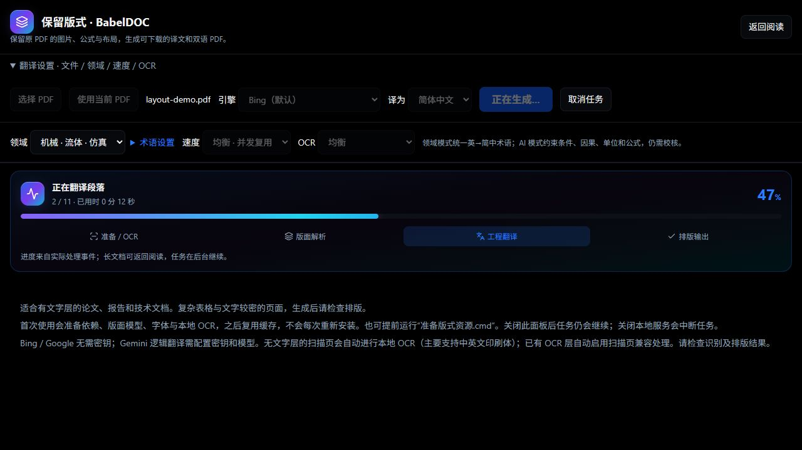

# 2026-10-13 优化验证

本轮新增工程领域与自定义术语、AI 段落完整性校验、数值差异提示、版式并发与连接复用、OCR 分档和内容缓存，以及页内插字导出。测试使用项目自制 PDF，不含用户文档。

## 可重复性能实验

安装版式依赖及资源后，用该环境 Python 运行 `tests/benchmark_layout.py`。BabelDOC 使用真实解析排版流程、两页夹具和延迟 1.5 秒的本地模拟翻译接口；每轮隔离翻译缓存。以下为 Windows 本机单次结果，不代表真实网络服务或所有 PDF 的加速比例。

| 测量 | 秒 |
| --- | ---: |
| BabelDOC 稳妥单任务 | 32.759 |
| BabelDOC 均衡并发 | 28.031 |
| OCR 均衡首次 / 缓存 | 1.593 / 0.004 |
| OCR 快速首次 / 缓存 | 1.293 / 0.004 |
| OCR 精细首次 / 缓存 | 1.813 / 0.004 |

此受控实验中完整版式流程耗时减少约 14%。OCR 使用一页自制清晰扫描件；未进行跨文档识别准确率评测。缓存命中只跳过重复 OCR，后续版面处理和翻译仍需时间。

## 功能验证

- TypeScript 检查、19 项 Node 测试与生产构建通过。
- OCR 回归 3 项、PDF 插字回归 1 项、BabelDOC 接口失败立即上报回归 1 项通过。
- 浏览器实测 Bing 工程术语翻译；新增中文注释经真实下载后，在 PDF 中可提取，原文件保持不变。
- Gemini 逻辑翻译入口与结果结构校验已实现；本机无 Gemini Key，未验证真实模型质量。
- 普通定位备注、画笔不包含在插字导出中；只有「插入文字」内容写入 PDF。

## 界面精修

后续视觉迭代统一新增模块的浅色 / 深色灰阶和青绿色强调色：文件参数卡、轻量批注工具栏、双栏粘贴面板、共享选中背景的视图切换、平滑实际进度。键盘焦点保持可见，系统减少动态效果时停用动效。已实测粘贴翻译、语言交换和完整 BabelDOC 任务。

